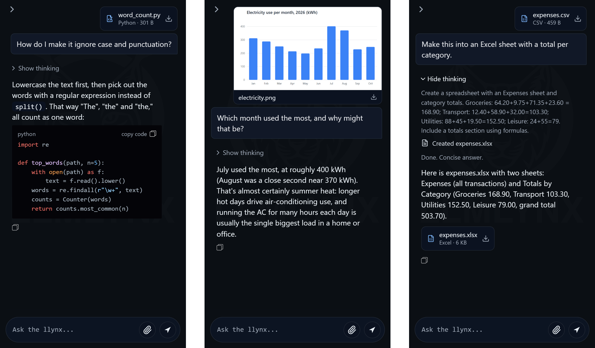
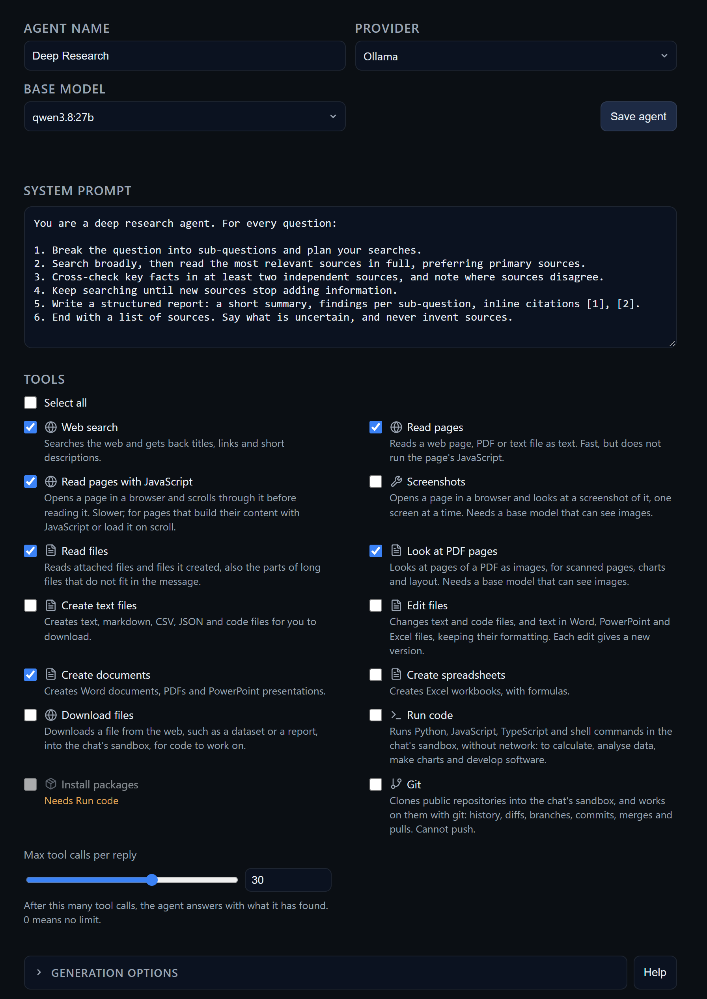
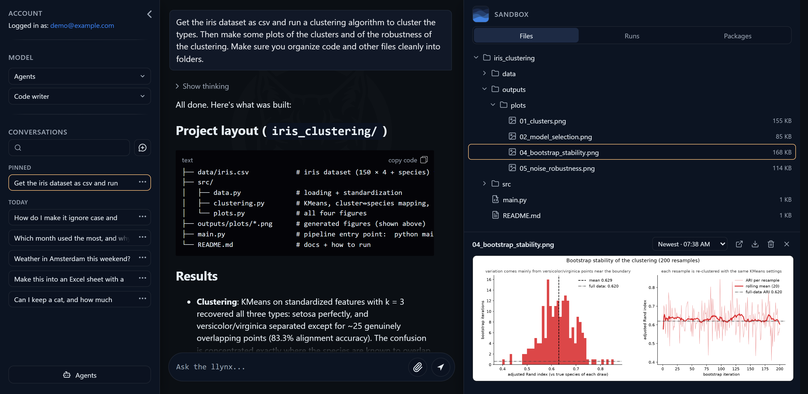

# LLMLYNX

<p align="center" style="padding:16px;">
  
</p>


---

## Overview

LLMLYNX is a lightweight harness and interface for Large Language Models (LLMs). It's designed with a local-first mindset and intended to get the most out of models that can run on consumer hardware. However, it supports models of any size, including external API calls through Open Router or OpenAI. Model interactions via [Ollama](https://ollama.ai/) and data storage happen locally so your data remains your own property.    

LLMLYNX is designed to be:

- **Self‑contained**: Can run entirely on your own machine or server, including inference.
- **Extensible**:  Define custom agents and enable tools as desired.
- **Secure**: web content is screened for prompt injection and malicious code, code execution happens inside of a sandbox environment.

This project is in active development, so expect things to break along the way. 

<p align="center" style="padding:16px;">
  
</p>

> ⚠️ **Warning:** LLMs hallucinate: they can sound convincing and still be wrong. 


---

## 🚀 Quick Start

You need Git, Node.js 20.9 or newer and Docker (Docker Desktop on Windows). For local models you need [Ollama](https://ollama.ai).

### Setup on Linux

```bash
git clone https://github.com/rudyvdbrink/llmlynx.git
cd llmlynx
node scripts/setup-env.mjs
docker compose run --rm web node_modules/.bin/prisma migrate deploy
docker compose up -d
```

Open http://localhost:3000 and sign up.

### Setup on Windows

```bash
git clone https://github.com/rudyvdbrink/llmlynx.git
cd llmlynx
npm install
npx prisma generate
npm run db:migrate
docker compose up -d searxng mcp-searxng browser egress files guard clamav code code-egress
npm run build
npm start
```

Open http://localhost:3000 and sign up.

---

## Usage

### Settings

Settings are in `.env`, which setup creates from `.env.example` with its secrets and package limits filled in. The file documents every setting; the most important ones are:

| Variable | Purpose |
|---|---|
| `ALLOWED_SIGNUP_EMAILS` | Comma-separated emails that may sign up. Empty allows everyone |
| `SYSTEM_PROMPT` | Default system prompt for Ollama models and agents |
| `OLLAMA_URL` | Default Ollama server, if it does not run on `http://localhost:11434`. Users can set their own |


### Model providers

Each user connects their own providers on the **Account** page (click your email at the top of the sidebar):

- **Ollama**: the address of an Ollama server, e.g. `192.168.1.20`. Without one, the `OLLAMA_URL` default is used.
- **OpenAI** and **OpenRouter**: an API key. The provider's models become available once a key is saved.

### Agents and tools

On the **Agents** page you combine a base model from any connected provider with a system prompt, tools and generation options. You can decide to enable individual tools for individual agents, including code execution and versioning with git.

<p align="center" style="padding:16px;">
  
</p>

Custom agents can search the web, read pages, take screenshots, read, create and edit files, download files, run code and use git if their tools are selected. Tools are off by default: on the **Agents** page, each tool has a checkbox. A tool is only offered when the agent's base model supports it (Ollama and the OpenRouter model list say whether a model can call tools and see images).

| Tool | Function | Requires |
|---|---|---|
| Web search | Searches the web through a private SearXNG instance | a model that can call tools |
| Read pages | Reads a page, PDF or text file as text, without running JavaScript | a model that can call tools |
| Read pages with JavaScript | Opens the page in a browser, scrolls through it, and reads what it shows | a model that can call tools |
| Screenshots | Opens the page in a browser and looks at one screen of it | a model that can call tools and see images |
| Read files | Reads attached files and files it created, also the parts of long files that did not fit in the message | a model that can call tools |
| Look at PDF pages | Looks at PDF pages as images, for scanned pages, charts and layout | a model that can call tools and see images |
| Create text files | Text, markdown, CSV, JSON and code files | a model that can call tools |
| Edit files | Find-and-replace edits in text and code files, and in the text of Word, PowerPoint and Excel files, whose formatting stays; Excel cells can be set. Each edit gives a new version | a model that can call tools |
| Create documents | Word, PDF and PowerPoint files, written by the model in markdown | a model that can call tools |
| Create spreadsheets | Excel workbooks, with formulas | a model that can call tools |
| Download files | Downloads a file, such as a dataset or a report, into the chat's sandbox, for code to work on | a model that can call tools |
| Run code | Runs Python, JavaScript, TypeScript and shell commands (such as pytest or npm test) in the chat's sandbox, without network. numpy, pandas, scipy, matplotlib, openpyxl, pillow and pytest are built in. Charts and pages it makes show in the chat | a model that can call tools |
| Install packages | Installs packages from PyPI and npm for the chat's code: ready-built wheels only, and npm packages without their install scripts | Run code |
| Git | Clones public repositories over HTTPS into the chat's sandbox, and runs git on them: history, diffs, branches, commits, merges and pulls. Nothing can be pushed | a model that can call tools |

An agent with any tool that works on files can also give you a file of its sandbox, as a card below its reply.

### The sandbox

A chat instance can create a dedicated sandbox, which is an isolated environment where code can run and files stored. Files are scanned for viruses before going into the sandbox and before being shown to the user. Code runs in a jail, with only a copy of the chat's files and no network or system file access, so it cannot reach the internet, your LAN, the app or the other containers. The sandbox thus lets the an agent modify and run code safely, and produce artifacts at your request.

<p align="center" style="padding:16px;">
  
</p>

All tools and guards run in their own containers:

| Container | Purpose |
|---|---|
| `searxng` | Metasearch engine. Not reachable from outside the stack |
| `mcp-searxng` | [mcp-searxng](https://github.com/ihor-sokoliuk/mcp-searxng): search and page reading, as an MCP server on `127.0.0.1:8790` |
| `browser` | `tools/browser`: headless Chromium for reading rendered pages and screenshots, as an MCP server on `127.0.0.1:8791` |
| `egress` | Proxy that all browser traffic goes through. It refuses private, loopback and LAN addresses |
| `files` | `tools/files`: reads, creates and edits files, as an MCP server on `127.0.0.1:8792`. Built on [MarkItDown](https://github.com/microsoft/markitdown) (documents to markdown), [pypdfium2](https://github.com/pypdfium2-team/pypdfium2) (PDF pages to images), [python-docx](https://github.com/python-openxml/python-docx), [python-pptx](https://github.com/scanny/python-pptx) and [openpyxl](https://openpyxl.readthedocs.io) (Office files), and [Pandoc](https://pandoc.org) with [Typst](https://typst.app) (documents from markdown). Files come and go in the calls: it keeps nothing and fetches nothing |
| `guard` | `tools/guard`: scans text for prompt injections with [Llama Prompt Guard 2](https://huggingface.co/meta-llama/Llama-Prompt-Guard-2-22M) on the CPU, as an MCP server on `127.0.0.1:8793`. Not a tool of the models: the app calls it for web content and attached files. See [Security](#security) |
| `clamav` | [ClamAV](https://www.clamav.net): scans attached files and web content for malware, on `127.0.0.1:3310`. Only its signature updates come from the internet |
| `code` | `tools/code`: runs code in [bubblewrap](https://github.com/containers/bubblewrap) jails without network (Python and Node.js), installs packages per chat, and runs git, as an MCP server. It reaches nothing but `code-egress` and clamd |
| `code-egress` | The code container's only way in and out: it passes the app's calls on (`127.0.0.1:8794`), lets installs reach PyPI and npm, and git's downloads reach public addresses over HTTPS, and nothing else |

---

## Security

**Secrets.** Passwords and recovery codes are stored as salted bcrypt hashes (never plain text). API keys for OpenAI and OpenRouter must stay readable to be used, so they are encrypted (AES-256-GCM). Setup creates the encryption key, and a random token for each container. The containers can only be reached from the machine itself and are gated by an access token. 

**Scanning.** Everything an agent gets from the internet is checked on the server before a model sees it. Nothing is sent to an outside service for this. ClamAV scans for viruses, and Llama Prompt Guard 2 scans for prompt injection. Files you attach yourself are scanned for viruses only.

- A virus: the file is refused, or the web content is thrown away.
- A prompt injection: the reply pauses, and you choose to remove the content and continue, or to stop. A chevron shows the text that was flagged.
- Content that could not be checked is withheld.

---

## 📄 License

The author retains full copyright. You are free to use and enjoy it, but you need permission to modify or adapt code. 
