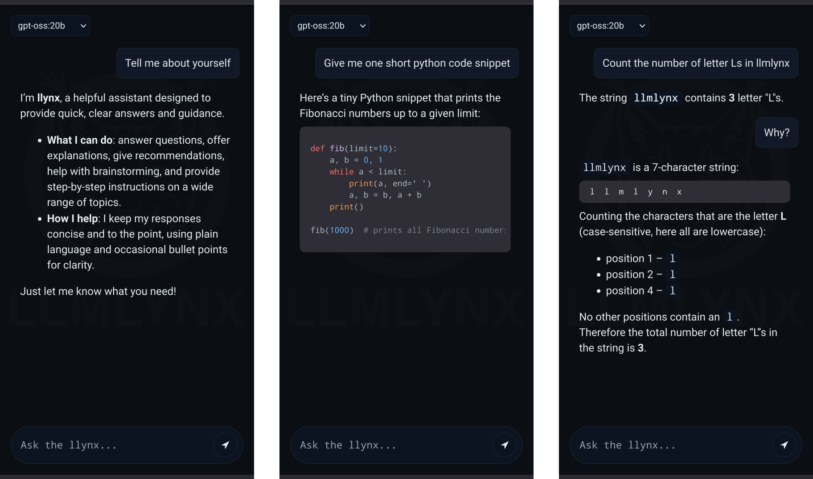

# LLMLYNX

<p align="center" style="padding:16px;">
  
</p>

> Fast, elegant, independent and free.

---

## Overview

LLMLYNX is a lightweight, Next.js–based web interface for interacting with Large Language Models (LLMs). Supported models include: GPT-oss (OpenAI), llama3 (Meta), Gemma3 (Google), deepseek-r1, quen3, mistral, and others. All model interactions and data storage happen locally so your data remains your own property. You can reach the UI through the browser and from any device within your local network: LLMLYNX is your personal LLM interface.

LLMLYNX is designed to be:

- **Self‑hosted** – run entirely on your own machine or server via [Ollama](https://ollama.ai/).
- **Extensible** – plug in custom agents, tools, or retrieval layers.
- **Secure by design** – system prompts and model control live server‑side.
- **Performant** – streams tokens in real time.
- **Organized** – clean separation of auth, chat UI, and API logic.

<p align="center" style="padding:16px;">
  
</p>

> ⚠️ **Warning:** LLMs hallucinate: they can sound convincing and still be wrong. 


---

## 🚀 Quick Start

### 1. Prerequisites

- Node.js ≥ 18.18
- npm (or pnpm / yarn)
- [Ollama](https://ollama.ai) installed and running locally (default: `http://localhost:11434`) via:
    ```bash
    ollama serve
    ```
- (Optional) Pulled at least one model:
  ```bash
  ollama pull gemma3:1b
  ```

### 2. Clone & Install

```bash
git clone git@github.com:rudyvdbrink/llmlynx.git
cd llmlynx
npm install
```

### 3. Configure Environment

Copy `.env.example` to `.env` and adjust it. The file documents every setting; the most important ones are:

| Variable | Purpose |
|---|---|
| `DATABASE_URL` | SQLite database file (required), e.g. `file:./dev.db` |
| `SECRETS_KEY` | Encrypts the users' API keys (required to save keys). Create one with `openssl rand -base64 32` |
| `SYSTEM_PROMPT` | Default system prompt for Ollama models and agents |
| `OLLAMA_URL` | Default Ollama server, if it does not run on `http://localhost:11434`. Users can set their own |
| `ALLOWED_SIGNUP_EMAILS` | Comma-separated emails that may sign up. Empty allows everyone |

### 3b. Connect Model Providers

Each user connects their own providers on the **Account** page (click your email at the top of the sidebar):

- **Ollama**: the address of an Ollama server, e.g. `192.168.1.20`. Without one, the `OLLAMA_URL` default is used.
- **OpenAI** and **OpenRouter**: an API key. The provider's models become available once a key is saved.

In the sidebar, the first dropdown picks the provider (or your agents) and the second one the model, with a search field.

The Account page is also where you change your password, log out, or delete your account.

### 3c. Agents

On the **Agents** page you combine a base model from any connected provider with a system prompt, tools and generation options. All agents appear together under **Agents** in the sidebar.

The generation options depend on the model, and open from the bar below the tools:

| Provider | Which options | Where that comes from | Options you do not change |
|---|---|---|---|
| Ollama | The same for every model | Fixed list; Ollama does not report per model | Sent with llmlynx's default values |
| OpenRouter | What the model takes | OpenRouter's public model list | Not sent, so the model's own default applies |
| OpenAI | What the model takes | OpenRouter's public model list, as OpenAI does not publish this; options it still refuses are left out of the request | Not sent, so the model's own default applies |

A model that is not in that list only offers its maximum output length. The list needs no key, and is loaded at most once an hour. The value an unchanged option shows is the model's own default where the list states it, otherwise the API's usual default.

OpenAI agents on models that reason (or are not in the list) run on the Responses API, because from GPT-5.4 on Chat Completions refuses tools unless reasoning is off. That API has no seed, stop sequences or penalties, so these models do not offer them. Models that do not reason, such as `gpt-4o`, stay on Chat Completions. Replies are not stored at OpenAI (`store: false`).

An agent is greyed out in the sidebar while its provider cannot be reached, its API key is missing or refused, or its base model is gone. Where a provider has announced a model's last day, the model lists show it. An agent whose model is gone keeps everything else: pick another base model on the Agents page.

### 3d. Agent Tools (optional)

Custom agents can search the web, read pages, take screenshots, and read, create and edit files. Tools are off by default: on the **Agents** page, each tool has a checkbox. A tool is only offered when the agent's base model supports it (Ollama and the OpenRouter model list say whether a model can call tools and see images).

| Tool | What it does | Needs |
|---|---|---|
| Web search | Searches the web through a private SearXNG instance | a model that can call tools |
| Read pages | Reads a page, PDF or text file as text, without running JavaScript | a model that can call tools |
| Read pages with JavaScript | Opens the page in a browser, scrolls through it, and reads what it shows | a model that can call tools |
| Screenshots | Opens the page in a browser and looks at one screen of it | a model that can call tools and see images, e.g. `qwen3.5:9b` |
| Read files | Reads attached files and files it created, also the parts of long files that did not fit in the message | a model that can call tools |
| Look at PDF pages | Looks at PDF pages as images, for scanned pages, charts and layout | a model that can call tools and see images |
| Create text files | Text, markdown, CSV, JSON and code files | a model that can call tools |
| Edit files | Find-and-replace edits in text and code files, and in the text of Word, PowerPoint and Excel files, whose formatting stays; Excel cells can be set. Each edit gives a new version | a model that can call tools |
| Create documents | Word, PDF and PowerPoint files, written by the model in markdown | a model that can call tools |
| Create spreadsheets | Excel workbooks, with formulas | a model that can call tools |

Below the checkboxes, a slider sets the most tool calls per reply (0 to 50, default 7; 0 means no limit). The model is told how many it has, and each result says how many are left. After that many, the agent answers with what it has found.

While an agent works, one status line shows what it is doing: "Thinking…", or a tool's icon (a globe for the web tools, a page for the file tools, a spanner for screenshots) with what the tool does. Below it, the reasoning and each finished tool call appear in the order they happened, screenshots included. Once the answer starts, all of it folds away behind "Show thinking". Web pages take up a lot of context: give agents with tools a context window of 16384 tokens or more.

**Files.** In a chat with an agent, the paperclip button left of Send attaches files (up to 10 per message, 20 MB each; pasting or dropping files works too): text and code files, markdown, CSV, JSON, PDF, Word, Excel, PowerPoint, and images for agents whose base model can see them. Before the model answers, each file is turned into text (scanned PDF pages, which have none, are sent as images to models that can see them, at most 5) and goes with the message, cut to about half of the context window; with Read files, the agent can read the rest. Files the agent creates or edits show as cards below its answer: a click downloads them, and images show in the chat. Attachments are stored in the database with the conversation. Only images are ever shown in the browser; every other file is only downloaded, so a file such as HTML cannot run in the app. Plain models (not agents) take no files.

The tools run in their own containers (see `docker-compose.yml`, profile `tools`):

| Container | Purpose |
|---|---|
| `searxng` | Metasearch engine. Not reachable from outside the stack |
| `mcp-searxng` | [mcp-searxng](https://github.com/ihor-sokoliuk/mcp-searxng): search and page reading, as an MCP server on `127.0.0.1:8790` |
| `browser` | `tools/browser`: headless Chromium for reading rendered pages and screenshots, as an MCP server on `127.0.0.1:8791` |
| `egress` | Proxy that all browser traffic goes through. It refuses private, loopback and LAN addresses |
| `files` | `tools/files`: reads, creates and edits files, as an MCP server on `127.0.0.1:8792`. Built on [MarkItDown](https://github.com/microsoft/markitdown) (documents to markdown), [pypdfium2](https://github.com/pypdfium2-team/pypdfium2) (PDF pages to images), [python-docx](https://github.com/python-openxml/python-docx), [python-pptx](https://github.com/scanny/python-pptx) and [openpyxl](https://openpyxl.readthedocs.io) (Office files), and [Pandoc](https://pandoc.org) with [Typst](https://typst.app) (documents from markdown). Files come and go in the calls: it keeps nothing and fetches nothing |

To use them, add these to `.env` (not `.env.local`: compose reads the tokens from `.env`), with secrets from `openssl rand -hex 32`:

```dotenv
SEARCH_MCP_URL=http://127.0.0.1:8790/mcp
SEARCH_MCP_TOKEN=<secret>
BROWSER_MCP_URL=http://127.0.0.1:8791/mcp
BROWSER_MCP_TOKEN=<secret>
FILES_MCP_URL=http://127.0.0.1:8792/mcp
FILES_MCP_TOKEN=<secret>
SEARXNG_SECRET=<secret>
```

Then start the containers. When the app itself runs outside Docker (`npm start` or `npm run dev`):

```bash
docker compose up -d searxng mcp-searxng browser egress files
```

In production, set `COMPOSE_PROFILES=tools` in `.env` as well, so that deploys build and start them with the app (see below). Restart the app after changing `.env`.

### 4. Create the Database

```bash
npm run db:migrate
npx prisma generate
```

Run `npm run db:migrate` again after pulling changes that add migrations.

### 5. Run

Production (faster, use this day to day):

```bash
npm run build
npm start
```

Development (hot reload):

```bash
npm run dev
```

Open: http://localhost:3000

Other scripts: `npm run lint`, `npm run typecheck`.

---

## Production deployment

The production server deploys itself: every push to `main` runs [`.github/workflows/deploy.yml`](.github/workflows/deploy.yml) on a self-hosted runner on the server. The workflow:

1. Resets the server's checkout to `origin/main`.
2. Builds the Docker image on the server.
3. Backs up the database to `data/backups/` (keeps the 20 newest).
4. Applies new migrations.
5. Restarts the app.
6. Waits until `/api/health` answers.

If the build or migration fails, the run stops and the running app keeps serving. If the new app does not become healthy, the run fails and shows its logs. Deploys can also be started by hand from the repo's Actions tab (**Run workflow**).

The server's checkout is only for deploying: every deploy discards edits to tracked files there. Its state is gitignored, so deploys leave it alone:

| Path | Contents |
|---|---|
| `data/llmlynx.db` | SQLite database |
| `data/backups/` | Database backups taken before each deploy |
| `logs/` | Auth log |
| `.env`, `.env.local` | Settings and secrets (see `.env.example`). Read at runtime, never built into the image |

The container uses the host network, so it reaches an Ollama server on the same machine at `http://localhost:11434`. It listens on port 3000, or on `WEB_PORT` if it is set in `.env`. The compose file overrides `DATABASE_URL` and `AUTH_LOG_DIR` from the env files with the paths above.

**Agent tools:** with `COMPOSE_PROFILES=tools` and the tool settings from section 3d in `.env`, every deploy also builds the `browser` and `files` images and starts the five tool containers. Without it, deploys run the app alone. The first deploy with tools is slow: the Playwright base image of `browser` is about 2 GB. The deploy only waits for the app to become healthy, so a tool container that fails does not stop a deploy; agents then report that the tool did not answer. Check them with `docker compose ps`. Update the Playwright version in `tools/browser` (Dockerfile and package.json) regularly, for example monthly: a pinned browser stops getting security fixes. The same goes for the pins in `tools/files` (Dockerfile and requirements.txt), which read files from users.

Useful commands in the checkout: `docker compose ps`, `docker compose logs -f web`, `docker compose restart web`.

### One-time server setup

1. Install Docker with the compose plugin and `sqlite3`. Add the user to the `docker` group.
2. Clone the repo to a fixed directory on the server. Create `.env` and/or `.env.local`, and the `data/` and `logs/` directories, owned by uid 1000 (the user the container runs as).
3. Register a runner: on GitHub, open the repo → Settings → Actions → Runners → New self-hosted runner (Linux, ARM64). Run the commands it shows in a directory of its own, outside the clone.
4. Tell the runner where the clone is: add `DEPLOY_DIR=<absolute path of the clone>` to the `.env` file in the runner's directory. The workflow reads it from there, so the path is not in the repo. Then install the runner as a service: `sudo ./svc.sh install $USER && sudo ./svc.sh start`.
5. Make the service restart itself and wait for a correct clock. GitHub rejects a runner whose clock is wrong, and the Pi has no battery-backed clock. Run `sudo systemctl edit actions.runner.<name>.service` (the name is in `ls /etc/systemd/system | grep actions`) and add:

   ```ini
   [Unit]
   StartLimitIntervalSec=0

   [Service]
   # runsvc.sh exits 0 even on fatal errors, so on-failure would never restart it.
   Restart=always
   RestartSec=60
   ExecStartPre=/bin/sh -c 'until [ "$(timedatectl show -p NTPSynchronized --value)" = yes ]; do sleep 5; done'
   TimeoutStartSec=infinity
   ```

6. Start the first deploy from the Actions tab, or push to `main`.

### Rolling back

To go back to an earlier version, reset the checkout and rebuild. The build is fast because Docker caches its layers:

```bash
git reset --hard <commit>
docker compose build && docker compose up -d
```

If a migration has to be undone as well, stop the app (`docker compose stop web`), copy a backup from `data/backups/` over `data/llmlynx.db`, and start it again. The next push to `main` deploys `main` again.

---

## Security

- **Passwords** and **recovery codes** are stored as salted bcrypt hashes. A recovery code is shown once at signup and cannot be retrieved afterwards.
- **Sessions**: the browser cookie holds a random token; the database stores only its SHA-256 hash. A copy of the database cannot be used to sign in.
- **Password reset** needs the account email plus the recovery code, and signs the account out on every device.
- The session cookie is `HttpOnly` and `SameSite=Lax`, and also `Secure` when the site is served over HTTPS (directly or behind a proxy that sets `X-Forwarded-Proto`).
- Login, signup and reset are rate limited per IP and written to the auth log (no passwords or codes are logged).
- **API keys** must stay readable to call the provider, so they cannot be hashed. Each user's keys are encrypted with AES-256-GCM under `SECRETS_KEY`, which lives only in `.env`. A copy of the database alone does not reveal them, and the page shows only the last four characters of a saved key.
- **Changing the password** needs the current password and signs the account out on every other device. **Deleting the account** needs the password and removes all of its data.
- Each user's **Ollama address** is contacted by the server, so any signed-in user can make the server send requests to addresses it can reach. Use `ALLOWED_SIGNUP_EMAILS` to limit who can sign up.
- **Agent tools** only read: they cannot click, fill in forms, log in or keep cookies. Pages cannot reach the LAN, the server or other containers. The page reader blocks private addresses itself, redirects included. All browser traffic goes through the `egress` proxy, which refuses private, loopback and link-local addresses after resolving names itself. Chromium keeps its sandbox (with Playwright's seccomp profile) and runs as an unprivileged user, and downloads are off. The two MCP servers listen on `127.0.0.1` only and need bearer tokens. Tool calls are rate limited per user.
- **Files**: attachments and the files agents create are only served to the user whose conversation they are in. Images show in the browser; every other file is served as a download only, with a sandboxing Content-Security-Policy, so an HTML or SVG file cannot run in the app. The `files` container gets each file in the call, keeps nothing, never fetches URLs, runs read-only as an unprivileged user without capabilities, and needs a bearer token. Pandoc runs in its sandbox mode and gets no raw HTML, TeX or Typst, so a document cannot read files or reach the network.
- **Text from web pages** can try to instruct the model (prompt injection). Agents are told to treat it as information, every tool call is shown in the chat, and images in replies are shown as links. The same goes for text in files, so a reply cannot make the browser fetch a URL by itself.

---

## System Prompt Handling

- The **system prompt is never taken from the client**. System messages in a request are dropped.
- For Ollama models and all agents, `src/app/api/chat/route.ts` adds the prompt to every request: the agent's own prompt if it has one, otherwise `SYSTEM_PROMPT`.
- OpenAI and OpenRouter models chosen directly, not through an agent, get no system prompt.
- Change it by editing `.env` and restarting the server.

Supports multiline via escaped newlines:

```dotenv
SYSTEM_PROMPT=You are the llynx.\nStay concise.\nIf unsure, say so.
```

---

## Streaming Architecture

1. Client sends: `{ model | agentId, conversationId, messages: [ {role:"user", content:"..."} , ... ] }`, where `model` is `ollama:<name>`, `openai:<name>` or `openrouter:<name>`
2. API route (`/api/chat`) stores the new user message and adds the system prompt.
3. API proxies to the user's Ollama server (`/api/chat` with `"stream": true`). OpenAI and OpenRouter models are streamed with the user's API key and converted to the same format.
4. The response is **newline-delimited JSON**: `{ message: { content } }` lines, then `{ done: true }`. When an agent uses a tool, a `{ tool: { id, name, icon, label, state: "running" } }` line announces the call, and a second one with the same `id` gives its outcome (`state` `"done"` or `"error"`, a new `label`, and `attachmentId` for a screenshot). The model then continues with the result, up to the agent's most tool calls per reply. Each step is stored as its own message.
5. Client:
   - Parses each line.
   - Accumulates `assistant` content.
   - Updates UI incrementally.
6. The reply is saved when the stream ends.

The Stop button aborts the request, which also cancels generation on Ollama, OpenAI or OpenRouter. The partial reply is kept.

---

## Project Layout

```
src/
  app/          Pages and API routes (Next.js App Router)
  components/   UI shared by several pages (app shell, sidebar)
  hooks/        Client data hooks shared by several pages
  lib/          Code shared by client and server (types, selection strings, validation)
  server/       Server-only code (auth, database, chat backends, agent tools, config)
prisma/         Database schema and migrations
tools/          Agent tool containers: SearXNG settings, the browser and files MCP servers, the egress proxy
```


## 📄 License

The author retains full copyright. You are free to use and enjoy it, but you need permission to modify or adapt code. 
