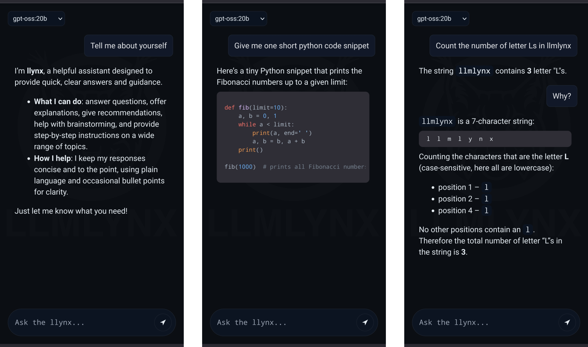

# LLMLYNX

<p align="center" style="padding:16px;">
  
</p>

> Fast, elegant, independent and free.

---

## Overview

LLMLYNX is a lightweight, Next.js–based web interface for interacting with Large Language Models (LLMs). Supported models include: GPT-oss (OpenAI), llama3 (Meta), Gemma3 (Google), deepseek-r1, quen3, mistral, and others. All model interactions and data storage happen locally so your data remains your own property. You can reach the UI through the browser and from any device within your local network: LLMLYNX is your personal LLM interface.

LLMLYNX is designed to be:

- **Self‑hosted** – run entirely on your own machine or server via [Ollama](https://ollama.ai/).
- **Extensible** – plug in custom agents, tools, or retrieval layers.
- **Secure by design** – system prompts and model control live server‑side.
- **Performant** – streams tokens in real time.
- **Organized** – clean separation of auth, chat UI, and API logic.

<p align="center" style="padding:16px;">
  
</p>

> ⚠️ **Warning:** LLMs hallucinate: they can sound convincing and still be wrong. 


---

## 🚀 Quick Start

### 1. Prerequisites

- Node.js ≥ 18.18
- npm (or pnpm / yarn)
- [Ollama](https://ollama.ai) installed and running locally (default: `http://localhost:11434`) via:
    ```bash
    ollama serve
    ```
- (Optional) Pulled at least one model:
  ```bash
  ollama pull gemma3:1b
  ```

### 2. Clone & Install

```bash
git clone git@github.com:rudyvdbrink/llmlynx.git
cd llmlynx
npm install
```

### 3. Configure Environment

Copy `.env.example` to `.env` and adjust it. The file documents every setting; the most important ones are:

| Variable | Purpose |
|---|---|
| `DATABASE_URL` | SQLite database file (required), e.g. `file:./dev.db` |
| `SECRETS_KEY` | Encrypts the users' API keys (required to save keys). Create one with `openssl rand -base64 32` |
| `SYSTEM_PROMPT` | Default system prompt for Ollama models |
| `OLLAMA_URL` | Default Ollama server, if it does not run on `http://localhost:11434`. Users can set their own |
| `ALLOWED_SIGNUP_EMAILS` | Comma-separated emails that may sign up. Empty allows everyone |

### 3b. Connect Model Providers

Each user connects their own providers on the **Account** page (click your email at the top of the sidebar):

- **Ollama**: the address of an Ollama server, e.g. `192.168.1.20`. Without one, the `OLLAMA_URL` default is used.
- **OpenAI** and **OpenRouter**: an API key. The provider's models become available once a key is saved.

In the sidebar, the first dropdown picks the provider (or your agents) and the second one the model, with a search field.

The Account page is also where you change your password, log out, or delete your account.

### 4. Create the Database

```bash
npm run db:migrate
npx prisma generate
```

Run `npm run db:migrate` again after pulling changes that add migrations.

### 5. Run

Production (faster, use this day to day):

```bash
npm run build
npm start
```

Development (hot reload):

```bash
npm run dev
```

Open: http://localhost:3000

Other scripts: `npm run lint`, `npm run typecheck`.

---

## Security

- **Passwords** and **recovery codes** are stored as salted bcrypt hashes. A recovery code is shown once at signup and cannot be retrieved afterwards.
- **Sessions**: the browser cookie holds a random token; the database stores only its SHA-256 hash. A copy of the database cannot be used to sign in.
- **Password reset** needs the account email plus the recovery code, and signs the account out on every device.
- The session cookie is `HttpOnly` and `SameSite=Lax`, and also `Secure` when the site is served over HTTPS (directly or behind a proxy that sets `X-Forwarded-Proto`).
- Login, signup and reset are rate limited per IP and written to the auth log (no passwords or codes are logged).
- **API keys** must stay readable to call the provider, so they cannot be hashed. Each user's keys are encrypted with AES-256-GCM under `SECRETS_KEY`, which lives only in `.env`. A copy of the database alone does not reveal them, and the page shows only the last four characters of a saved key.
- **Changing the password** needs the current password and signs the account out on every other device. **Deleting the account** needs the password and removes all of its data.
- Each user's **Ollama address** is contacted by the server, so any signed-in user can make the server send requests to addresses it can reach. Use `ALLOWED_SIGNUP_EMAILS` to limit who can sign up.

---

## System Prompt Handling

- The **system prompt is never taken from the client**. System messages in a request are dropped.
- For Ollama models, `src/app/api/chat/route.ts` adds the prompt to every request: the agent's own prompt if it has one, otherwise `SYSTEM_PROMPT`.
- OpenAI and OpenRouter models get no system prompt.
- Change it by editing `.env` and restarting the server.

Supports multiline via escaped newlines:

```dotenv
SYSTEM_PROMPT=You are the llynx.\nStay concise.\nIf unsure, say so.
```

---

## Streaming Architecture

1. Client sends: `{ model | agentId, conversationId, messages: [ {role:"user", content:"..."} , ... ] }`, where `model` is `ollama:<name>`, `openai:<name>` or `openrouter:<name>`
2. API route (`/api/chat`) stores the new user message and adds the system prompt.
3. API proxies to the user's Ollama server (`/api/chat` with `"stream": true`). OpenAI and OpenRouter models are streamed with the user's API key and converted to the same format.
4. The response is **newline-delimited JSON**: `{ message: { content } }` lines, then `{ done: true }`.
5. Client:
   - Parses each line.
   - Accumulates `assistant` content.
   - Updates UI incrementally.
6. The reply is saved when the stream ends.

The Stop button aborts the request, which also cancels generation on Ollama, OpenAI or OpenRouter. The partial reply is kept.

---

## Project Layout

```
src/
  app/          Pages and API routes (Next.js App Router)
  components/   UI shared by several pages (app shell, sidebar)
  hooks/        Client data hooks shared by several pages
  lib/          Code shared by client and server (types, selection strings, validation)
  server/       Server-only code (auth, database, chat backends, config)
prisma/         Database schema and migrations
```


## 📄 License

The author retains full copyright. You are free to use and enjoy it, but you need permission to modify or adapt code. 
